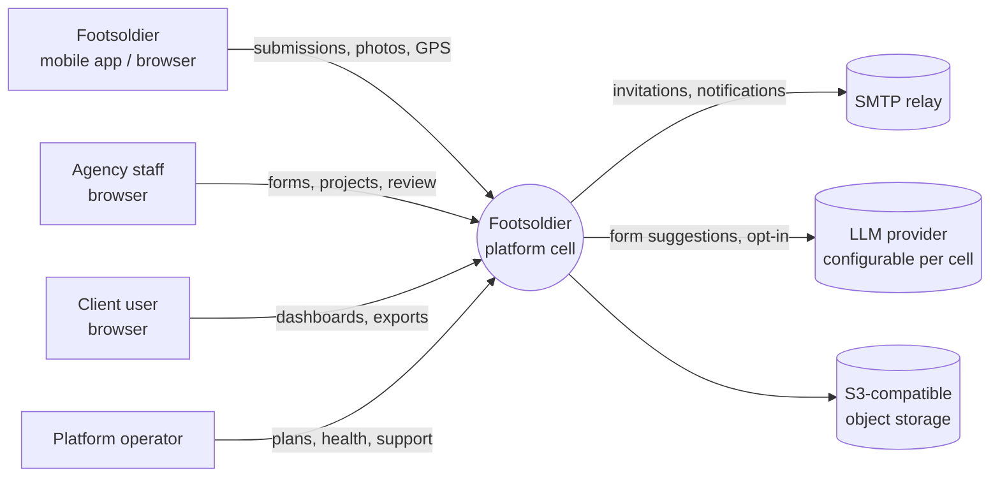

# 01 — Context, goals and constraints

## Actors

| Actor | Who | Main jobs |
|-------|-----|-----------|
| **Agency staff** | Employees of a field-research / marketing agency (owners, admins, supervisors) | Set up clients and projects, build forms, recruit and assign footsoldiers, review data, decide what clients see, compute footsoldier pay |
| **Client user** | Staff of the organization that commissioned the research | Watch progress in near real time, explore dashboards, export what they are allowed to |
| **Footsoldier** | Field agent hired by the agency | Accept invitation, see assigned projects, fill forms (often offline), attach photos and GPS, see own progress and earnings |
| **Platform operator** | The company running Footsoldier | Onboard agencies, manage plans and billing, keep the platform healthy — without reading tenant data |

## Business goals

1. **Trustworthy data.** A client should be able to rely on every number in their dashboard.
2. **No campaign requires code.** A new client project is configuration (form + dashboard),
   never a migration.
3. **Works where the work happens.** Low-end Android phones, intermittent 2G/3G, shared
   devices, power cuts.
4. **Sellable as SaaS.** Many agencies, each with many clients; free and paid tiers.
5. **Deployable under data-residency law.** For example, Rwanda's Law No. 058/2021, Art. 50,
   requires personal data to be stored in Rwanda unless the NCSA has authorised otherwise.

## Quality attributes (ranked)

When two of these conflict, the higher one wins.

| Rank | Attribute | What it means here | Measure (initial target) |
|------|-----------|--------------------|--------------------------|
| 1 | **Data durability & integrity** | A captured submission is never lost, duplicated or silently changed | 0 lost submissions; every submission traceable device → server → report |
| 2 | **Tenant isolation & privacy** | No agency or client ever sees another's data | 0 cross-tenant reads; automated isolation tests on every tenant model |
| 3 | **Availability of capture** | Footsoldiers can always capture, even with no server | Mobile capture works 100% offline; server API 99.5% monthly |
| 4 | **Simplicity / operability** | A small team can run a cell on modest hardware | Single-VM cell possible; ≤ 4 components on the request path (app, Postgres, object store, SMTP) — observability tooling is counted separately and is optional on the small cell |
| 5 | **Portability** | No dependency on one cloud vendor | Runs on any Linux host with Docker |
| 6 | **Timeliness** | Clients see data shortly after it reaches the server | Dashboard reflects new submissions in ≤ 60 s (p95) |
| 7 | **Usability** | Agency admins build forms without help; footsoldiers need minimal training | Usability checks per release |
| 8 | **Cost efficiency** | Viable price for African markets | Cell infra cost tracked per active agency |

## Constraints

- **Ruby on Rails** for the server where possible (team skill, existing repo).
- **No hard dependency on AWS or any single cloud** — every external service must have a
  self-hostable or in-country alternative.
- **Data residency per deployment** — personal data of a jurisdiction stays in that
  jurisdiction's cell, including backups, logs and error reports.
- **Low-resource environments** — small servers, unreliable connectivity, low-end devices.
- **Browser first, mobile next** — phase 1 capture is in the browser with connectivity;
  the offline mobile app follows, and the architecture must not need rework to support it.
  *Revised:* the Phase 1 web filler still autosaves drafts locally and retries submits, so a
  dropped connection never loses a form ([05](05-mobile-and-offline-sync.md)).
- **Identity by email.** Invitations, confirmation and password reset go by email. A phone
  number is required for footsoldiers so they can be reached (optional for other users), and
  it is not a login ([ADR-0011](../adr/0011-user-identity-is-email.md), decided 2026-11-09).
- **Humans merge.** Agents open pull requests; a person reviews and merges.

## Assumptions (to validate)

| Assumption | Used for | If wrong |
|------------|----------|----------|
| *Revised:* per cell, first 2 years: ≤ 200 agencies, ≤ 5,000 active footsoldiers, **≤ 100k submissions/day planning peak** (20 per active footsoldier); **500k/day is the ceiling** at which the database moves to a dedicated host | Sizing Postgres-only design; `submission_values` and `audit_events` partitioned by month from day one (`submissions` stays one table, see [ADR-0010](../adr/0010-reporting-projection.md)) | Dedicated DB host, then read replica; still no new components. (v0.1 assumed 500k/day as the normal peak, which is ~10M projection rows a day and not a small-VM workload.) |
| *Confirmed 2026-11-09:* footsoldiers work for several agencies, and agents borrow each other's phones | Device session per user, cursor per agency; one account logged in per phone at a time, and logout only once the outbox has synced ([05](05-mobile-and-offline-sync.md)) | — (no longer an assumption) |
| Photos are the main media; video is rare | Simple single-request attachment upload | Add resumable (chunked) uploads |
| A submission is authored by one footsoldier on one device | Append-only sync with no merge conflicts | Introduce per-field revision merge for collaborative records |
| Clients don't need raw SQL/BI tool access in v1 | In-app dashboards | Add read-only replica + Metabase/Superset per cell |

## Out of scope for v1

- Paying footsoldiers (we compute earnings; payment happens outside the platform).
- Public/anonymous survey links (respondent fills the form themselves).
- Cross-cell data sharing.
- Native desktop apps.
