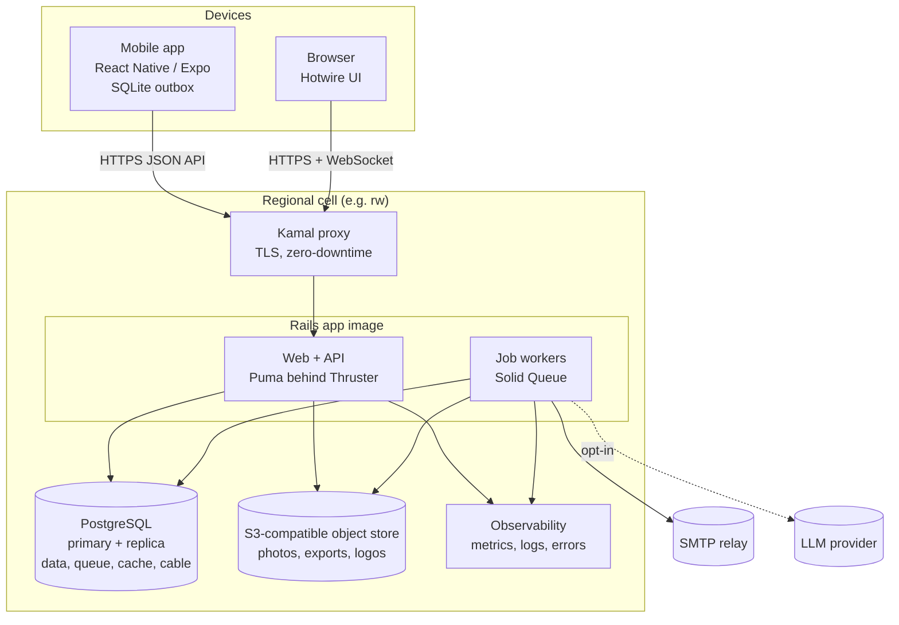
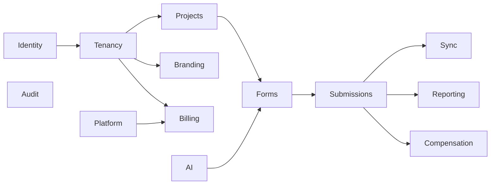

# 02 — System overview

## Containers (one regional cell)



Everything stateful is in **PostgreSQL** or the **object store**. The Rails image runs in two
roles (web, jobs) from the same build. This is deliberately the smallest set of moving parts
that meets the requirements ([ADR-0003](../adr/0003-modular-monolith.md),
[ADR-0008](../adr/0008-vendor-neutral-regional-cells.md)).

## Technology choices

| Concern | Choice | Why |
|---------|--------|-----|
| Language / framework | Ruby 4.0, Rails 8.1 (latest stable at scaffold time) | Team skill; Rails 8 ships auth generator, Solid Queue/Cache/Cable, Kamal, Thruster |
| Database | PostgreSQL 17+ | JSONB, row-level security, partitioning, mature replication and backup tooling |
| Jobs / cache / WebSockets | Solid Queue, Solid Cache, Solid Cable | Postgres-backed — no Redis to operate |
| Web UI | Hotwire (Turbo + Stimulus), Tailwind CSS 4 with CSS variables for theming | Server-rendered, fast on low-end devices, little JS to maintain |
| JS bundling | `jsbundling-rails` with esbuild | Needed to bundle the shared TypeScript form runtime ([ADR-0006](../adr/0006-shared-form-logic.md)) |
| Authorization | Pundit policies | Explicit, testable per-action rules |
| Charts / maps | Chart.js; MapLibre GL JS with self-hostable tiles (PMTiles) | No tile/map vendor lock-in; tiles can be served from the cell |
| File storage | Active Storage on an S3-compatible service (or Disk for the smallest cell) | Portable across providers |
| Deployment | Docker images, Kamal 2 | Deploys to any Linux host over SSH |
| Mobile | React Native via Expo, TypeScript, SQLite (expo-sqlite + Drizzle) | Offline-first, one codebase for Android/iOS, shares TS form runtime ([ADR-0009](../adr/0009-mobile-stack.md)) |
| AI | `ruby_llm` (provider-agnostic) behind an internal adapter | Swap providers per cell, including a local model ([09](09-optional-features.md)) |

Exact versions are pinned when the skeleton is generated; this table states intent, not
lockfile contents.

## Modules (bounded contexts) inside the monolith

The monolith is split into namespaces with one-directional dependencies. Each module owns its
tables; other modules call its public classes (models, service objects, query objects), not
its tables directly.



| Module | Owns | Notes |
|--------|------|-------|
| `Identity` | users (identified by email), sessions, device sessions, invitations, 2FA | Global within a cell |
| `Tenancy` | agencies, clients, memberships, `Current` tenant context, RLS helpers | The tenant boundary |
| `Projects` | projects, assignments | Activation, revocation |
| `Forms` | forms, form versions, choice lists, form spec validation, builder | Pure data + Ruby form runtime |
| `Submissions` | submissions, attachments, reviews, quality flags | Write path, append-only |
| `Sync` | API v1 controllers for devices, sync cursors | Thin layer over Projects/Forms/Submissions |
| `Reporting` | answer projection, dashboards, widgets, exports, client view config | Read path |
| `Branding` | themes, logos, custom domains | Agency and client themes |
| `Compensation` | rates, earnings ledger, statements | Opt-in, entitlement-gated |
| `Billing` | plans, subscriptions, entitlements, usage counters | Paid vs free features |
| `Audit` | append-only audit events | Used by every module |
| `Platform` | operator console, support access grants | Never reads answer content |
| `AI` | form suggestion, (later) dashboard narration | Opt-in, entitlement-gated, provider adapter |

Boundaries are enforced by convention and code review at first. If they start to erode,
add [packwerk](https://github.com/Shopify/packwerk) — not before.

## Repository layout (monorepo)

```
/                         Rails application (web + API + jobs)
  app/models/<module>/    namespaced per module above
  app/controllers/api/v1/ device sync API
  app/javascript/         Stimulus controllers, form renderer (web)
  config/deploy*.yml      Kamal config per cell
packages/
  form-spec/              JSON Schema for form definitions + conformance test vectors
  form-runtime/           TypeScript form runtime (logic only, no UI) used by web and mobile
mobile/                   Expo app
docs/
  architecture/           these documents
  adr/                    decision records
  api/openapi.yaml        device API contract
.agents/                  agent working notes (git-ignored, see 12)
```

Rails stays at the repository root so Rails and Kamal conventions work without configuration.

## Request paths

**Agency builds and publishes a form** → `Forms` validates the definition against
`form-spec` → creates an immutable `FormVersion` → `Sync` cursor bumps for assigned
footsoldiers → devices fetch the new version on next sync.

**Footsoldier submits** → device writes to its SQLite outbox → `PUT /api/v1/submissions/:id`
(idempotent) → `Submissions` stores the raw payload → *Revised:* a job **immediately**
validates with the Ruby runtime, records quality flags (including `attachments_pending`),
writes the reporting projection and creates earnings entries if enabled → Turbo Stream
broadcast refreshes dashboards → attachments upload separately; when the last one lands the
flag is cleared and the submission is re-projected. Photos trailing on 2G never delay the
dashboard.

**Client opens dashboard** → `Reporting` resolves the client view config for that project
→ queries the projection with only client-visible fields → renders widgets with the
client's theme.
