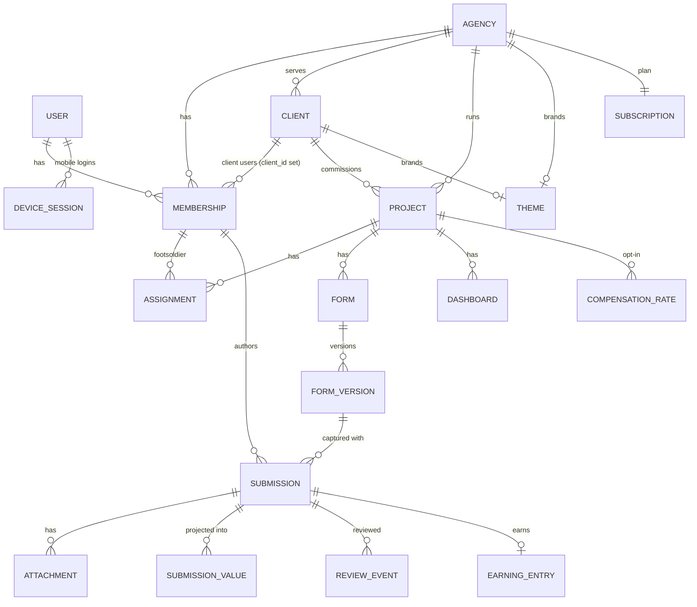

# 03 — Domain model and access control

## Core entities

### Identity and tenancy

| Entity | Key fields | Notes |
|--------|-----------|-------|
| `User` | email (citext, nullable, unique), phone (E.164, nullable, unique), name, password_digest, confirmed_at, locale, otp_secret | One identity per person per cell; at least one of email/phone. Not tenant-scoped. *Revised:* [ADR-0011](../adr/0011-user-identity-email-or-phone.md). |
| `Agency` | slug, name, status (`active`/`suspended`), data_region | **The tenant root.** |
| `Client` | agency_id, name, status | Belongs to exactly one agency. A real-world organization served by two agencies is two `Client` records (isolation over convenience — see open question 2). |
| `Membership` | agency_id, user_id, client_id (nullable), role, status, invited_by | A user's role in one agency. Client users have `client_id` set. A user can hold memberships in several agencies. *Revised:* unique on `(agency_id, user_id, client_id)`. |
| `Invitation` | agency_id, email **or phone**, role, client_id, token_digest, expires_at, accepted_at | Email link or SMS code → set password / confirm → membership activated. |
| `DeviceSession` | user_id, device_id, token_digest, platform, app_version, last_seen_at, `state` (`active`/`draining`/`revoked`), revoked_at, drain_until | Long-lived, revocable API token per device. *Revised:* `draining` lets a removed member's outbox finish uploading ([05](05-mobile-and-offline-sync.md)). Belongs to the user, not to one agency. |
| `PlatformStaff` | email, password_digest, otp_secret, role | **Separate table and login** from tenant users. |

Roles on `Membership`:

| Role | Scope |
|------|-------|
| `agency_owner` | Everything in the agency, including billing and deleting data |
| `agency_admin` | Clients, projects, forms, members, client view config, exports |
| `agency_supervisor` | Assigned projects only: review submissions, view dashboards, manage assignments |
| `footsoldier` | Assigned, active projects only: capture and view own submissions and earnings |
| `client_admin` | Projects of their client: dashboards, exports allowed by the agency, invite client viewers |
| `client_viewer` | Projects of their client: dashboards only |

One membership = one role. Someone who is both a supervisor and a footsoldier holds the higher
role; capture permission for supervisors is a project setting, not a second role.

### Projects

| Entity | Key fields | Notes |
|--------|-----------|-------|
| `Project` | agency_id, client_id, name, description, status, starts_on, ends_on, settings (jsonb) | `status`: `draft` → `active` ⇄ `paused` → `closed`. Only `active` projects accept new captures. |
| `Assignment` | agency_id, project_id, membership_id, status, activated_at, revoked_at, revoked_by_id | Footsoldier ↔ project. Revocation is a status change, never a delete. |

Project settings (typed via `store_accessor`, validated): `gps_policy`
(`off`/`optional`/`required`), `share_location_with_client`, `pseudonymize_footsoldiers_for_client`,
`compensation_enabled`, `review_mode` (`none`/`sample`/`all`), `retention_days`.

### Forms and submissions

Detailed in [04](04-forms-and-submissions.md). Summary:

| Entity | Notes |
|--------|-------|
| `ChoiceList` | *Revised:* agency-owned (or platform-provided) named option list, versioned; supports hierarchies (`parent_value`) for cascading selects such as Rwanda's administrative units. Referenced by `choices_from`. |
| `Form` | Belongs to a project; has a stable `key`. Can be duplicated into another project. |
| `FormVersion` | `definition` (jsonb), `version` (int), `status` (`draft`/`published`/`retired`), `checksum`. Published = immutable. |
| `Submission` | Client-generated UUIDv7 id; `answers` (jsonb, as captured); device/timing/location metadata; `state` and `review_status`. Never updated in place except status columns. *Revised:* `kind` (`capture`/`follow_up`/`correction`) and nullable `parent_submission_id` from Phase 1, so follow-up records and corrections need no later migration. Partitioned by month. |
| `SubmissionConflict` | *Revised:* quarantined payload received with an existing id but a different checksum; visible to agency admins and support, never reported. |
| `Attachment` | Client-generated UUID; belongs to submission + field key; Active Storage blob; checksum. |
| `SubmissionValue` | Typed projection row per answered field (for analytics). Rebuildable. |
| `ReviewEvent` | Append-only: accepted / flagged / rejected / note, by whom, why. |
| `Correction` | *Revised, Phase 1:* a `Submission` of kind `correction` whose `answers` hold only the changed keys, authored by the reviewer, with a reason. Reports read the latest correction over the original; the original is never modified. |

### Every tenant-owned table has `agency_id`

Even when derivable through a parent (e.g. `submissions.project_id → projects.agency_id`),
`agency_id` is denormalized onto the row. This makes tenant scoping a single indexed predicate
and makes PostgreSQL row-level security possible ([ADR-0004](../adr/0004-multi-tenancy.md)).

Primary keys: `bigint` for server-created rows; **UUIDv7** for anything a device creates
(submissions, attachments), so ids can be generated offline and still sort by time.

*Revised:* child tables carry **composite foreign keys** to their parent,
`(agency_id, project_id) REFERENCES projects (agency_id, id)`, so the denormalized
`agency_id` can never disagree with the parent's. Pre-tenant queries (a user's own
memberships, invitation lookup, device login) have explicit user-keyed RLS policies rather
than bypassing RLS ([ADR-0004](../adr/0004-multi-tenancy.md)).

## Authorization

Authorization has three layers, all of which must pass:

1. **Tenant context** — the request resolves `Current.agency` from the membership the user
   selected (agency switcher for multi-agency users). All tenant models are scoped to it, and
   the DB session variable for RLS is set to it.
2. **Role** — Pundit policy for the action, based on `Current.membership.role`.
3. **Resource scope** — supervisors and footsoldiers are limited to projects they're assigned
   to; client users to their client's projects; footsoldiers to their own submissions.

### Permission matrix (v1)

| Action | owner | admin | supervisor | footsoldier | client_admin | client_viewer | platform |
|--------|:-----:|:-----:|:----------:|:-----------:|:------------:|:-------------:|:--------:|
| Manage billing / plan | ✓ | | | | | | ✓ (plan) |
| Manage members & invitations | ✓ | ✓ | assign only | | client viewers | | |
| Manage clients | ✓ | ✓ | | | | | |
| Create / edit projects | ✓ | ✓ | | | | | |
| Build & publish forms | ✓ | ✓ | | | | | |
| Capture submissions | | | if allowed | assigned + active | | | |
| View submissions (raw) | ✓ | ✓ | assigned | own | if allowed by agency | | |
| Review / flag / reject | ✓ | ✓ | assigned | | | | |
| Configure client view | ✓ | ✓ | | | | | |
| View dashboards | ✓ | ✓ | assigned | own stats | client-visible | client-visible | |
| Export data | ✓ | ✓ | | | if allowed | | |
| See compensation | ✓ | ✓ | assigned | own | | | |
| Brand agency / client | ✓ | ✓ | | | | | |
| Read answer content | | | | | | | only via support grant |

## Lifecycle rules worth stating explicitly

- **Revoking an assignment** stops new captures from the next sync, but submissions captured
  *before* `revoked_at` (by device capture time, with clock-skew tolerance) are still
  accepted — and flagged for review if they arrive after revocation.
- **Pausing a project** blocks new captures; in-flight data is still accepted.
- **Removing a member** deactivates the membership and puts their device sessions into
  `draining` for 30 days: the device may still upload captures made before the removal and
  nothing else ([05](05-mobile-and-offline-sync.md)). Their submissions stay, attributed to
  them. An owner may **hard-revoke** instead (audited; the UI warns that unsynced captures
  will be lost).
- **Deleting is rare and explicit.** Only `agency_owner` can delete a project's data, through
  an audited, delayed (soft → hard after N days) process.
