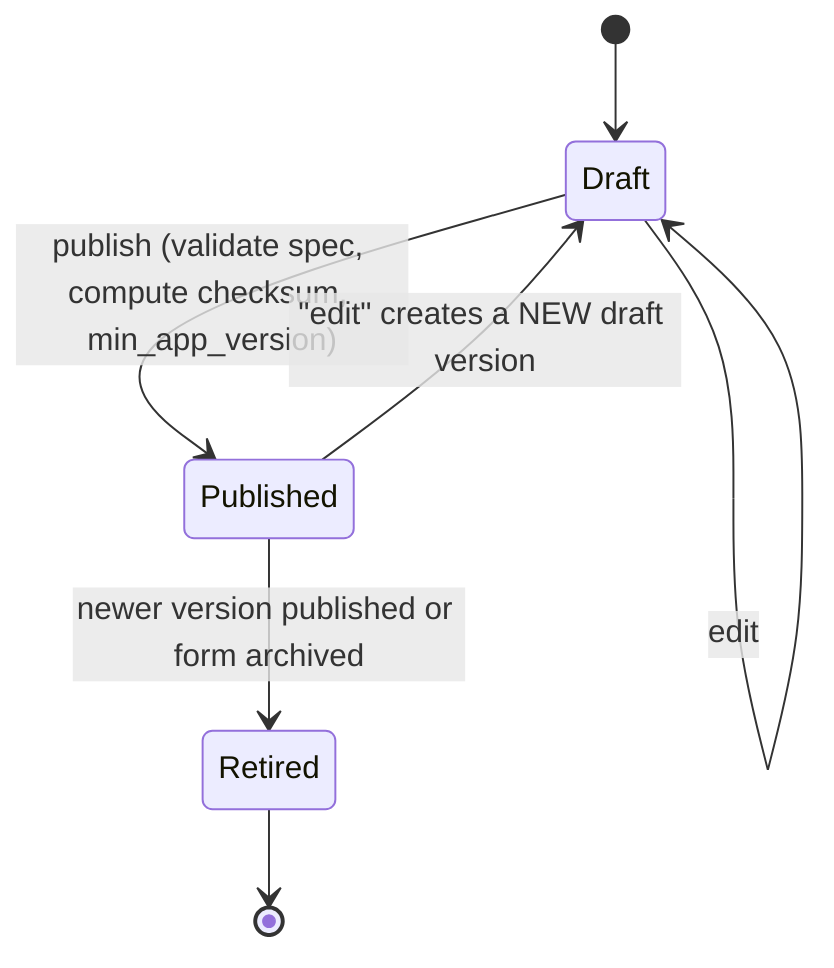
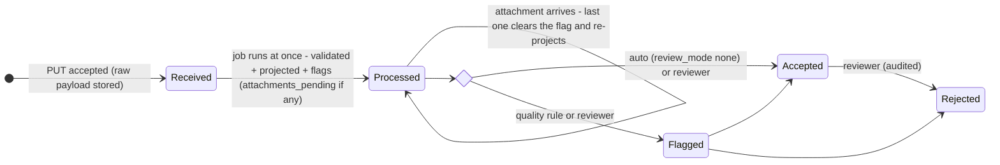

# 04 — Forms and submissions

## Principles

1. **A form is a JSON document**, validated against a JSON Schema in `packages/form-spec`.
2. **Published versions are immutable.** Editing a published form creates a new draft version.
3. **A submission records the exact form version** it was captured with, forever.
4. **Logic is declarative** (JSONLogic), so the server, the browser and the mobile app evaluate
   it identically ([ADR-0006](../adr/0006-shared-form-logic.md)).
5. **Capture what happened, then judge it.** The server stores what the device sent before
   validating it; validation failures become flags, not data loss.

## Form definition format (spec v1)

```json
{
  "spec": "footsoldier.form/1",
  "title": { "en": "Merchant visit", "rw": "Gusura umucuruzi" },
  "default_locale": "en",
  "settings": { "gps": "required", "gps_max_accuracy_m": 50 },
  "fields": [
    { "key": "merchant_name", "type": "text", "label": { "en": "Merchant name" },
      "required": true, "pii": false, "max_length": 120 },
    { "key": "upi_accepted", "type": "select_one", "label": { "en": "UnionPay accepted?" },
      "options": [
        { "value": "tested", "label": { "en": "Accepted, tested" } },
        { "value": "not_allowed", "label": { "en": "Accepted, test not allowed" } },
        { "value": "no", "label": { "en": "Not accepted" } }
      ], "required": true },
    { "key": "why_not", "type": "text", "label": { "en": "Why not accepted?" },
      "visible_if": { "==": [ { "var": "upi_accepted" }, "no" ] }, "required": true },
    { "key": "district", "type": "select_one", "label": { "en": "District" },
      "choices_from": "rw_admin_units", "level": "district" },
    { "key": "sector", "type": "select_one", "label": { "en": "Sector" },
      "choices_from": "rw_admin_units", "level": "sector", "cascade_from": "district" },
    { "key": "tests", "type": "group", "repeat": { "min": 0, "max": 3 },
      "label": { "en": "Payment tests" },
      "fields": [
        { "key": "method", "type": "select_one", "options": [ "…" ] },
        { "key": "result", "type": "select_one", "options": [ "…" ] },
        { "key": "code", "type": "text", "pattern": "^[0-9A-Z]{2}$" }
      ] },
    { "key": "shopfront", "type": "photo", "max_count": 2 },
    { "key": "location", "type": "geopoint", "required": true }
  ]
}
```

### Field types (v1)

`text`, `long_text`, `integer`, `decimal`, `select_one`, `select_many`, `boolean`, `date`,
`time`, `datetime`, `phone`, `email`, `geopoint`, `photo`, `group` (optionally `repeat`),
`note` (display only), `calculated` (JSONLogic expression, stored).

*Revised:* `select_one`/`select_many` may take options from a shared **choice list**
(`choices_from`) and cascade on another field (`cascade_from`) in v1 — every Rwandan address
needs it, and the legacy forms prove it.

Later: `signature`, `barcode`, `audio`, `geotrace`/`geoshape`, `rating`, `matrix`, file upload.

### Field attributes

| Attribute | Purpose |
|-----------|---------|
| `key` | Stable machine name, unique within its group, `snake_case`. Never reused for a different meaning across versions. |
| `label`, `hint` | Localized strings (`en`, `rw`, `fr`, `sw` …). |
| `required` | Boolean or JSONLogic expression. |
| `visible_if` | JSONLogic; hidden fields are not required and their answers are dropped. |
| `validate` | List of `{ "rule": <JSONLogic>, "message": {…} }`. |
| `pii` / `sensitive` | Privacy classification; drives client visibility defaults, exports, retention ([07](07-security-privacy-residency.md)). |
| `unique_within` | `project` → duplicates are flagged (legacy: unique national ID). |
| `client_visible` | Default for the client view; the agency can override per project. |
| `respondent_identifier` | Marks fields (phone, national ID) used to find a respondent's records for follow-up or data-subject requests. |

### Logic expressions (JSONLogic, as constrained by the spec)

*Revised* ([ADR-0006](../adr/0006-shared-form-logic.md)):

- **Operators** are an allowlist; `==` is strict (no coercion); anything outside the list
  fails spec validation.
- **Custom operators** (implemented in both runtimes, covered by conformance vectors):
  `date_diff(a, b, unit)`, `today()`, `matches(string, regex)` with an RE2-safe regex subset,
  and `count`, `sum`, `any`, `all` over a repeat group.
- **Scoping:** inside a repeat, `{"var": "result"}` refers to the current instance;
  `{"var": "/merchant_name"}` addresses the root; `{"var": "$index"}` is the instance index.

### Spec evolution

- The `spec` string is versioned. Runtimes refuse definitions with a newer major spec than they
  support, and the server will not publish a form using features the oldest supported mobile
  app version can't render (`min_app_version` is computed per form version).
- Adding field types is a minor spec change; changing semantics of an existing construct is a
  major one.
- *Revised — publish-time lints across versions of one form:* a key's **type never changes**
  (use a new key); option **`value`s are stable** (labels may change, values may be added or
  retired); removing a key is allowed and leaves historical data queryable. Dashboards take
  labels from the latest published version that still carries the key or value.

## Form lifecycle



- Exactly one published version per form at a time. Retired versions still accept submissions
  that were started on them (devices pin in-progress drafts to their version).
- Publishing is audited and broadcast to the sync cursor of every assigned footsoldier.
- **Form builder UI:** a Hotwire page with a field list (drag to reorder), a field inspector
  panel, and a live preview rendered by the same TS form runtime used for capture. The builder
  edits a draft `definition` via small PATCH operations (add/move/update/remove field), with
  autosave. Validation errors from the spec appear inline before publish.
- **AI-assisted drafting** (opt-in) produces a *draft* definition from the project description;
  the admin edits and publishes as usual ([09](09-optional-features.md)).

## Submissions

### Lifecycle



Two separate columns: `state` (pipeline: received → processed) and `review_status`
(pending / accepted / flagged / rejected), plus `attachments_complete` (boolean).
*Revised:* processing no longer waits for attachments — on 2G photos can trail answers by
hours, and the dashboard target is 60 s. Reporting counts **accepted** submissions by
default, with a toggle to include pending.

### What a submission stores

| Group | Fields |
|-------|--------|
| Identity | `id` (UUIDv7 from device), `agency_id`, `project_id`, `form_version_id`, `membership_id`, `device_id`, `kind`, `parent_submission_id` |
| Content | `answers` (jsonb exactly as captured), `payload_sha256`, `attachment_manifest` |
| Time | `started_at`, `captured_at` (device clock), `received_at` (server), `clock_skew_s` (from sync handshake) |
| Location | `location` (PostGIS-free: `lat`, `lng` numeric + `accuracy_m`, `altitude_m`, `fix_at`, `provider`, `is_mocked`) |
| Source | `channel` (`web`/`android`/`ios`/`legacy_import`), `app_version` |
| Status | `state`, `review_status`, `flags` (jsonb array of `{code, detail}`) |

Answers are never edited. *Revised:* a **Correction** (a submission of kind `correction`
with `parent_submission_id`, holding only the changed keys, with author and reason) changes
what reports show while keeping the original. Available to reviewers from Phase 1, because
the legacy app's `edited_by` column shows the need arose in the first campaign.

### Quality flags (data accuracy)

Computed in the processing job; each is a rule with a code, so new rules are cheap to add:

| Code | Rule |
|------|------|
| `validation_failed` | Server-side runtime disagrees with the device (should never happen; signals a runtime bug or tampering) |
| `gps_missing` / `gps_inaccurate` | Required GPS absent or accuracy worse than threshold |
| `gps_mocked` | OS reports a mock location provider |
| `too_fast` | Duration below a project-specific minimum |
| `duplicate_value` | `unique_within: project` field collides with an existing submission |
| `late_after_revocation` | Captured before but received after assignment revocation |
| `clock_suspect` | Device clock skew above threshold |
| `attachments_pending` | *Revised:* answers processed, one or more attachments not yet received |
| `id_conflict` | *Revised:* a later `PUT` with this id carried a different checksum; the payload is in `submission_conflicts` |

Flags inform review; they never delete data.

## GPS

- Captured per `geopoint` field and optionally once per submission (form `settings.gps`).
- The capture UI waits for a fix up to a timeout, shows live accuracy, and accepts once
  accuracy ≤ threshold. If no acceptable fix is possible, the footsoldier can proceed with the
  best fix plus a mandatory reason (configurable), which raises `gps_inaccurate`.
- Stored as plain numeric columns (no PostGIS dependency in v1). Add PostGIS only if we need
  spatial queries (geofences, "submissions within territory").
- Shown to clients only if the project enables `share_location_with_client`.

## Media

- Photos are compressed on device (long edge ≤ 1600 px, JPEG quality ~70, EXIF GPS stripped
  unless the project wants it) before entering the outbox — typically 200–500 KB.
- Each attachment has a device-generated UUID and SHA-256; upload is an idempotent
  `PUT` ([05](05-mobile-and-offline-sync.md)). *Revised:* the endpoint reserves
  `Content-Range` on `PUT` and a `HEAD` that reports bytes received, so resumable upload can
  be added later without a new API version.
- Stored via Active Storage on the cell's object store; served to browsers through
  short-lived signed URLs, never public.
