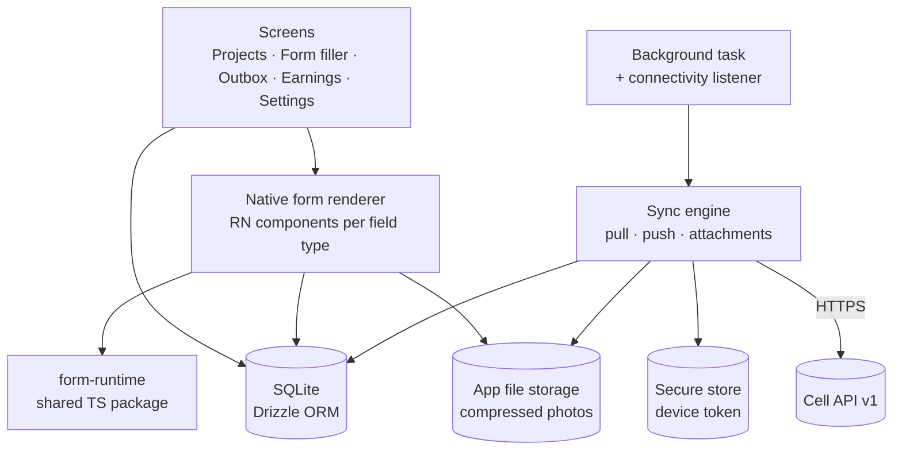
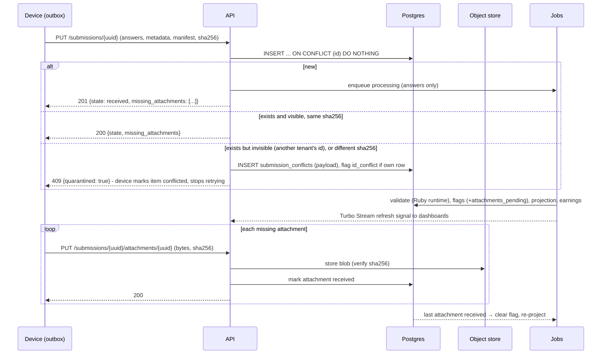

# 05 — Mobile app and offline sync

Phase 1 captures in the browser with connectivity. The offline-first mobile app follows in
phase 2. Both use **the same submission API and the same form runtime**, so mobile adds a
client — it does not change the server.

## Design rules

1. **The device is the source of truth until the server acknowledges.** Nothing is deleted
   locally until the server confirms the submission *and* every attachment by checksum.
2. **Every write is idempotent.** Ids are generated on the device (UUIDv7). Retrying any request
   any number of times produces the same result.
3. **Submissions are append-only.** One author, one device → no merge conflicts to resolve.
4. **The server accepts what it can authenticate.** Validation problems become flags
   ([04](04-forms-and-submissions.md)); only authentication/authorization failures are refused.
5. **Never block uploading.** Forced app updates, expired projects, revoked assignments and
   *removed memberships* must still let the outbox drain first. *Revised:* this is what the
   `draining` device-session state is for; rate limits never reject honest `PUT`s.
6. **Assume bad clocks and bad networks.** Record device, server and GPS time; use small
   payloads, gzip, exponential backoff with jitter.

## Mobile app architecture

| Concern | Choice |
|---------|--------|
| Framework | Expo (React Native, TypeScript), current SDK at start of phase 2 |
| Local DB | `expo-sqlite` with Drizzle ORM and versioned migrations |
| Secrets | `expo-secure-store` for the device token |
| Location | `expo-location` (high accuracy, mock-provider detection on Android) |
| Camera | `expo-camera` / `expo-image-picker` + `expo-image-manipulator` for compression |
| Background | `expo-background-task` plus sync on app foreground, on connectivity regained and a manual "Sync now" |
| i18n | English, Kinyarwanda, French, Swahili from day one (strings externalized) |
| Updates | Store releases; OTA JS updates via the open `expo-updates` protocol (EAS Update or a self-hosted update server) |
| Target devices | Android 8+ with 2 GB RAM is the baseline we test on; iOS current-minus-two |

### Local tables (device)

| Table | Purpose |
|-------|---------|
| `projects`, `assignments` | What this footsoldier may capture for |
| `form_versions` | Cached immutable definitions (by id + checksum) |
| `drafts` | In-progress captures, pinned to a form version |
| `outbox_submissions` | Finished captures: payload, checksum, `sync_state`, attempts, last_error |
| `outbox_attachments` | File path, checksum, size, `sync_state` |
| `sync_meta` | Cursor **per agency**, last successful sync, server clock offset, min app version |

`sync_state`: `queued` → `uploading` → `acknowledged` → (all attachments acknowledged) →
`done`. `done` rows are kept for N days (configurable) for the footsoldier's history, then
pruned.

### Login and offline access

- First login requires connectivity: email + password (or invitation link) → server issues a
  long-lived, revocable **device token** bound to `device_id`.
- The app then requires a local PIN or biometric to open, so it works offline and protects a
  lost phone. Revoking the device session server-side takes effect on next contact; pending
  data is still uploaded before the local session is wiped.
- Invitation links carry the cell base URL, so the app knows which regional cell to talk to.
- *Revised:* `device_id` is a UUID generated at first launch and kept in the secure store
  (Expo exposes no stable hardware id).
- *Revised — multiple agencies (confirmed 2026-11-09: footsoldiers work for several
  agencies):* a device session belongs to the user. `GET /sync` returns
  changes for **every active footsoldier membership**, with one cursor per agency; projects
  are grouped by agency in the UI; each outbox row carries its `agency_id`.
- *Revised — removed members:* when a membership is removed the session becomes `draining`
  for 30 days: `PUT` of submissions and attachments captured before `revoked_at` (plus clock
  tolerance) still succeeds; every other call returns `401 {reason: "draining"}`. The app
  drains, then wipes the local session. A hard revoke returns `401 {reason: "revoked"}` and
  the app keeps the outbox read-only on the phone for support.
- **Borrowed phones** (decided 2026-11-09: footsoldiers lend each other phones). The app holds
  one account at a time. A footsoldier who borrows a phone logs in with their own details once
  the current user has logged out. Logging out requires an empty outbox, so the app syncs
  first and says so when there is no connection; the previous user's captures are never left
  behind or discarded. Logging out then wipes that account's local data, so the borrower sees
  none of it. On the server, the borrower gets their own `DeviceSession` for the same
  `device_id`, and a `shared_device` quality flag marks a phone that captured for more than
  one footsoldier in the same project on the same day ([04](04-forms-and-submissions.md)).

## Sync protocol (API v1)

All endpoints are under `/api/v1`, JSON, gzip, authenticated with
`Authorization: Bearer <device token>`. The contract is written in `docs/api/openapi.yaml`
and enforced by request tests ([10](10-testing-strategy.md)).

| Method & path | Purpose | Idempotency |
|---------------|---------|-------------|
| `POST /sessions` | Exchange credentials for a device token | — |
| `DELETE /sessions/current` | Logout (after outbox is empty) | ✓ |
| `GET /sync?cursors[<agency_id>]=<n>` | Delta since cursor, per agency: assignments, project status, form version refs, revocations, choice-list versions, server time, min app version | Read |
| `GET /form_versions/:id` | Immutable definition; `ETag` = checksum, cache forever | Read |
| `GET /choice_list_versions/:id` | Immutable choice-list version pinned by a form version; cache forever | Read |
| `PUT /submissions/:uuid` | Create submission | Same id + same checksum → `200`; same id + different checksum → `409 {quarantined: true}` (payload stored in `submission_conflicts`) |
| `PUT /submissions/:uuid/attachments/:uuid` | Upload one file (body = bytes, `Content-SHA256` header; `Content-Range` reserved for resumable upload later) | Same id + same checksum → `200` |
| `HEAD /submissions/:uuid/attachments/:uuid` | Bytes received so far (reserved for resumable upload) | Read |
| `GET /submissions?before=<uuid>` | Own submission history (review outcome, flags, earnings), paged by id. *Revised:* changes to these arrive through `GET /sync`, not through a timestamp `since=` | Read |

### Sync cursor

*Revised.* Every change a device cares about (assignment, project status, form version
publication, choice-list version, revocation) appends a row to `sync_events`
(`agency_id`, `seq`, `kind`, `subject_id`, `membership_id` or null). `GET /sync` returns rows
with `seq > cursor` for that footsoldier's memberships, plus the new cursor per agency. This
avoids timestamp comparisons across machines with different clocks. Review outcomes and
earnings changes on a footsoldier's own submissions are events too (scoped to the
membership), so they share the same gap-free stream instead of a separate `since=` timestamp.

A device with **no cursor** for an agency (first login, new membership) or a cursor **older
than the event retention window** (90 days) receives a **snapshot** of its current state
(active assignments, current form and choice-list versions, project statuses) and the current
`seq`, not a replay of the agency's history. Events older than the window are pruned, so the
table stays small.

`seq` is assigned **under a per-agency transaction-scoped advisory lock**
(`pg_advisory_xact_lock(agency_id)`), so events become visible in `seq` order. Stamping a
sequence value on rows at write time is not enough: with two concurrent writers, `seq` 10
can commit after a device has already read past 11, and the device would never see 10 —
a missed revocation or form version. The idempotency suite tests this with concurrent
writers ([10](10-testing-strategy.md)). The lock is held only for the short transaction that
writes the event, and these writes are rare next to submissions (which never take it), so
serialising them per agency costs nothing noticeable.

### Upload sequence

Retries use exponential backoff with jitter (cap ~15 min) and resume from whatever the server
says is missing. A submission is `done` on the device only when the server reports
`missing_attachments: []`.

### Edge cases we design for

| Situation | Behaviour |
|-----------|-----------|
| App killed mid-upload | Request is retried; `ON CONFLICT` makes it a no-op if it had landed |
| Phone clock wrong by days | `captured_at` kept as-is; `clock_skew_s` from sync handshake stored; `clock_suspect` flag |
| Project paused/assignment revoked while offline | Captures already made are uploaded and accepted (flagged if late); new captures blocked after next sync |
| Form republished while footsoldier has a draft | Draft stays on its version; new captures use the new version |
| App version too old | Server returns `min_app_version`; app uploads outbox first, then blocks new captures and prompts update |
| Storage nearly full | App warns, refuses new photo captures before the DB can't write |
| Phone lent while the owner's outbox is not empty | Logout is refused until the outbox has synced; the borrower logs in afterwards with their own details |
| Duplicate tap on submit (web or mobile) | Same client-generated id → single submission |
| *Revised:* phone clock wrong by months or years | TLS certificate validation fails and nothing can sync. The app recognises the TLS error class, tells the footsoldier to fix the phone's date and time, and leaves the outbox untouched |
| *Revised:* membership removed while the outbox is full | Session is `draining`; captures made before removal upload; new captures are blocked |
| *Revised:* `PUT` answered `409` | Payload is quarantined server-side; device marks the item `conflicted`, keeps it visible in the outbox history, and stops retrying |
| *Revised:* two writers bump the sync cursor concurrently | Advisory lock serialises `seq`; no device skips an event |

## Phase 1 (web capture) uses the same rules

The browser form filler generates the submission UUID when the form opens, uses the TS runtime
for logic, and submits through the same idempotent create path (via a Rails controller that
shares the `Submissions::Ingest` service with the API). Moving from web to mobile changes the
client only.

*Revised:* the Phase 1 campaign will run on field networks, so the web filler also
**autosaves the draft to IndexedDB** under its submission UUID, **retries** the idempotent
submit with backoff while the tab is open, and restores the draft on reload. Photos are
resized in the browser before upload. This is not offline capture — a user who closes the
browser with the server unreachable must come back to the draft — but a dropped connection
or a crash no longer loses a form. Local drafts are keyed by user, so the next person on a
borrowed device never sees them, and each is deleted once the server acknowledges the
submission. Logout is refused while a finished submission is still unacknowledged (send it, or
discard it explicitly after a warning); unfinished drafts are deleted at logout after a
warning.
