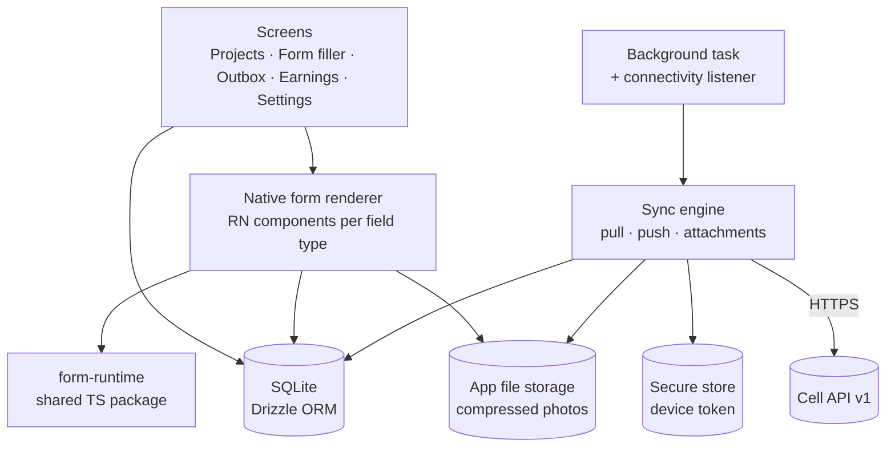
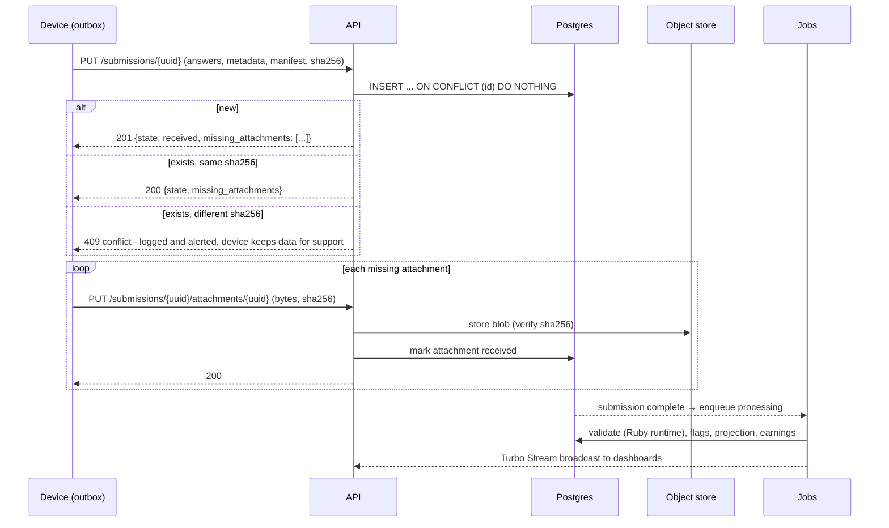

# 05 — Mobile app and offline sync

Phase 1 captures in the browser with connectivity. The offline-first mobile app follows in
phase 2. Both use **the same submission API and the same form runtime**, so mobile adds a
client — it does not change the server.

## Design rules

1. **The device is the source of truth until the server acknowledges.** Nothing is deleted
   locally until the server confirms the submission *and* every attachment by checksum.
2. **Every write is idempotent.** Ids are generated on the device (UUIDv7). Retrying any request
   any number of times produces the same result.
3. **Submissions are append-only.** One author, one device → no merge conflicts to resolve.
4. **The server accepts what it can authenticate.** Validation problems become flags
   ([04](04-forms-and-submissions.md)); only authentication/authorization failures are refused.
5. **Never block uploading.** Forced app updates, expired projects or revoked assignments must
   still let the outbox drain first.
6. **Assume bad clocks and bad networks.** Record device, server and GPS time; use small
   payloads, gzip, exponential backoff with jitter.

## Mobile app architecture

| Concern | Choice |
|---------|--------|
| Framework | Expo (React Native, TypeScript), current SDK at start of phase 2 |
| Local DB | `expo-sqlite` with Drizzle ORM and versioned migrations |
| Secrets | `expo-secure-store` for the device token |
| Location | `expo-location` (high accuracy, mock-provider detection on Android) |
| Camera | `expo-camera` / `expo-image-picker` + `expo-image-manipulator` for compression |
| Background | `expo-background-task` plus sync on app foreground, on connectivity regained and a manual "Sync now" |
| i18n | English, Kinyarwanda, French, Swahili from day one (strings externalized) |
| Updates | Store releases; OTA JS updates via the open `expo-updates` protocol (EAS Update or a self-hosted update server) |
| Target devices | Android 8+ with 2 GB RAM is the baseline we test on; iOS current-minus-two |

### Local tables (device)

| Table | Purpose |
|-------|---------|
| `projects`, `assignments` | What this footsoldier may capture for |
| `form_versions` | Cached immutable definitions (by id + checksum) |
| `drafts` | In-progress captures, pinned to a form version |
| `outbox_submissions` | Finished captures: payload, checksum, `sync_state`, attempts, last_error |
| `outbox_attachments` | File path, checksum, size, `sync_state` |
| `sync_meta` | Cursor, last successful sync, server clock offset, min app version |

`sync_state`: `queued` → `uploading` → `acknowledged` → (all attachments acknowledged) →
`done`. `done` rows are kept for N days (configurable) for the footsoldier's history, then
pruned.

### Login and offline access

- First login requires connectivity: email + password (or invitation link) → server issues a
  long-lived, revocable **device token** bound to `device_id`.
- The app then requires a local PIN or biometric to open, so it works offline and protects a
  shared or lost phone. Revoking the device session server-side takes effect on next contact;
  pending data is still uploaded before the local session is wiped.
- Invitation links carry the cell base URL, so the app knows which regional cell to talk to.

## Sync protocol (API v1)

All endpoints are under `/api/v1`, JSON, gzip, authenticated with
`Authorization: Bearer <device token>`. The contract is written in `docs/api/openapi.yaml`
and enforced by request tests ([10](10-testing-strategy.md)).

| Method & path | Purpose | Idempotency |
|---------------|---------|-------------|
| `POST /sessions` | Exchange credentials for a device token | — |
| `DELETE /sessions/current` | Logout (after outbox is empty) | ✓ |
| `GET /sync?cursor=<n>` | Delta since cursor: assignments, project status, form version refs, revocations, server time, min app version | Read |
| `GET /form_versions/:id` | Immutable definition; `ETag` = checksum, cache forever | Read |
| `PUT /submissions/:uuid` | Create submission | Same id + same checksum → `200`; same id + different checksum → `409` + alert |
| `PUT /submissions/:uuid/attachments/:uuid` | Upload one file (body = bytes, `Content-SHA256` header) | Same id + same checksum → `200` |
| `GET /submissions?since=` | Own submission statuses (review outcome, flags) and earnings | Read |

### Sync cursor

A per-agency monotonically increasing `bigint` (`sync_version`) is stamped on every row that
devices care about (assignments, project status, form version publication). `GET /sync`
returns changes with `sync_version > cursor` for that footsoldier, plus the new cursor. This
avoids timestamp comparisons across machines with different clocks.

### Upload sequence

Retries use exponential backoff with jitter (cap ~15 min) and resume from whatever the server
says is missing. A submission is `done` on the device only when the server reports
`missing_attachments: []`.

### Edge cases we design for

| Situation | Behaviour |
|-----------|-----------|
| App killed mid-upload | Request is retried; `ON CONFLICT` makes it a no-op if it had landed |
| Phone clock wrong by days | `captured_at` kept as-is; `clock_skew_s` from sync handshake stored; `clock_suspect` flag |
| Project paused/assignment revoked while offline | Captures already made are uploaded and accepted (flagged if late); new captures blocked after next sync |
| Form republished while footsoldier has a draft | Draft stays on its version; new captures use the new version |
| App version too old | Server returns `min_app_version`; app uploads outbox first, then blocks new captures and prompts update |
| Storage nearly full | App warns, refuses new photo captures before the DB can't write |
| Duplicate tap on submit (web or mobile) | Same client-generated id → single submission |

## Phase 1 (web capture) uses the same rules

The browser form filler generates the submission UUID when the form opens, uses the TS runtime
for logic, and submits through the same idempotent create path (via a Rails controller that
shares the `Submissions::Ingest` service with the API). Moving from web to mobile changes the
client only.
