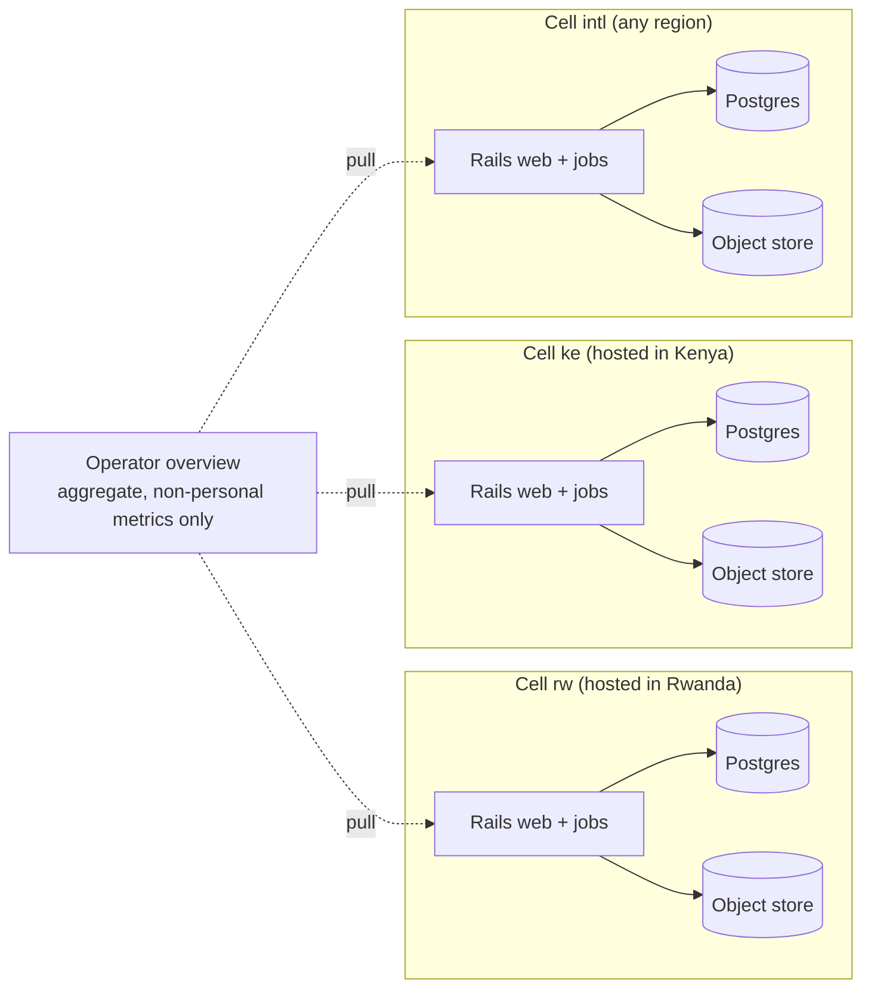

# 08 — Deployment and operations

## Regional cells

A **cell** is a complete, independent deployment of Footsoldier for one jurisdiction or
customer group: its own hosts, database, object store, backups and monitoring. Cells share the
codebase and release train, nothing else.

- Hostnames: `<cell>.footsoldier.<tld>` (e.g. `rw.footsoldier.app`); agency custom domains later.
- Kamal config per cell: `config/deploy.yml` (shared) + `config/deploy.<cell>.yml`
  (destination), deployed with `kamal deploy -d <cell>`.
- A future **cell directory** (tiny, personal-data-free service mapping agency slug → cell URL)
  lets users log in from a single domain. Until then invitation links carry the cell URL.

## Environments

Decided 2026-11-09.

| Environment | Where | Data | Deployed with |
|-------------|-------|------|---------------|
| **Demo** | The team's Contabo server, managed by Coolify, next to other apps | Full flow, **no real campaign data** | Coolify |
| **Production cell** | Linux servers in the client's jurisdiction, from the first signed client | Real data | Kamal |

### Demo on Coolify

The demo runs everything: invitations, accounts, form building, capture, review, dashboards
and exports. It holds **no real campaign data** (no real respondents' answers, IDs, phone
numbers, photos or locations) for two reasons. Contabo has no data centre in Rwanda, and
Rwanda's Law No. 058/2021 (Art. 50) keeps personal data in the country unless the NCSA has
authorised otherwise. And the demo does not meet the durability targets (one shared disk,
single-copy file storage, periodic dumps). Demo accounts ask only for a name and work email,
and the sign-up page says the demo is hosted outside Rwanda; confirm with counsel that this is
enough.

- **App:** the same image CI builds for production, pulled from GitHub's container registry;
  CI triggers Coolify's deploy webhook. One container runs web and jobs
  (`SOLID_QUEUE_IN_PUMA`) until load calls for a separate worker.
- **Postgres:** a Coolify-managed database holding the four Rails databases (primary, cache,
  queue, cable). The app connects as a **restricted role**, never Coolify's default `postgres`
  user: a superuser bypasses row-level security ([07](07-security-privacy-residency.md)).
  Migrations run as the owner role.
- **Files:** Garage from Coolify's service templates, used through Active Storage's S3 service
  (path-style addressing). Direct browser uploads and the bucket's CORS rule are tested early,
  because that is where S3-compatible stores most often differ.
- **Backups:** Coolify's scheduled database dumps and a scheduled copy of Garage's buckets go to
  a bucket **off the server**; the weekly restore test reads from there.

### Kamal dry run

Before any client signs, and at the end of Phase 0 if the team has capacity, the production
path is proven once on a throwaway VM: deploy the same image with the Kamal configuration the
cells will use, set up continuous WAL archiving off the host, restore from it on a separate
host, record what broke, and delete the VM. Without it, the first client's cell would be the
first time Kamal and the WAL backups ever run.

## Runtime components per cell

| Component | Minimum ("small cell") | Recommended ("standard cell") |
|-----------|-------------------------|-------------------------------|
| Rails web (Puma + Thruster) | 1 container | 2 hosts behind Kamal proxy / load balancer |
| Rails jobs (Solid Queue) | same host | 1 dedicated host |
| PostgreSQL | same host, 4 vCPU / 8 GB VM total | Primary + streaming replica on dedicated hosts |
| Object store | Active Storage `Disk` on an attached volume. *Revised:* this is the same disk as the database, so **backups must leave the host** (below) | S3-compatible store (provider's, or self-hosted e.g. Garage / SeaweedFS / Ceph RGW — evaluate maintenance and licensing at selection time) |
| SMTP | In-country relay | Same |
| Monitoring | Same host | Dedicated small host |

The small cell exists so that a pilot in a new country can start on one VM from a local
provider, and grow without architectural change. *Revised:* the one non-negotiable even on
the small cell is a **second location in-country for backups** (a bucket from a local
provider, or a second small VM reached over SSH). Failover to a replica, where one exists,
is **manual** by runbook; the 4 h RTO allows it and automatic failover would add a consensus
component we do not want to run.

## Why Postgres-only

Solid Queue, Solid Cache and Solid Cable put jobs, cache and WebSocket pub/sub in Postgres.
That removes Redis (a component with its own persistence, failover and memory sizing) from
every cell. The trade-off is extra load on Postgres; at the planning peak in
[01](01-context-and-goals.md) (100k submissions/day, about 2M projection rows/day) that is
comfortable on a standard cell, and queue/cache can be moved to a separate Postgres database
on the same server (Rails supports multiple databases) before anything else changes.
*Revised:* `submission_values` and `audit_events` are partitioned by month from the first
migration, so growth toward the 500k/day ceiling is handled by adding a dedicated database
host, not by re-partitioning live tables. `submissions` stays a single table so that its
primary key on `id` keeps uploads idempotent ([ADR-0010](../adr/0010-reporting-projection.md)).

## Releases and migrations

- One Docker image per commit on `main`, tagged with the git SHA; built in CI.
- Deploy order: demo (Coolify) → production cells, one at a time.
- **Zero-downtime migrations** using expand/contract; `strong_migrations` blocks unsafe ones.
  Every migration must be backward compatible with the currently deployed code.
- Feature flags (Flipper, Active Record adapter) separate deploy from release; entitlements
  ([09](09-optional-features.md)) are a separate concept from flags.
- **Mobile releases** are decoupled: the API is versioned (`/api/v1`), additive changes only
  within a version, and the server keeps supporting app versions ≥ `min_app_version` for at
  least 90 days after a new release.

## Backups and recovery

| Item | Approach | Target |
|------|----------|--------|
| Postgres | Continuous WAL archiving + nightly base backups (pgBackRest or WAL-G) to object storage **in the same jurisdiction and never on the database host**, second copy at a different site in-country. *Revised:* on the small cell this means an in-country bucket or a second VM, not the local `Disk` store | RPO ≤ 5 min, RTO ≤ 4 h |
| Object store | Versioning on, replicated or synced to a second site | RPO ≤ 24 h |
| Config / secrets | Kamal secrets in the operator's password manager | — |
| Restore drills | Automated weekly restore of the latest backup into a scratch DB + row-count check; manual full DR drill quarterly | Drill passes |

Devices are part of durability: data stays on the phone until acknowledged
([05](05-mobile-and-offline-sync.md)), so a server-side restore to a point before an upload is
healed by devices re-uploading (idempotent).

## Observability

Everything runs inside the cell so no personal data leaves it.

| Signal | Tooling |
|--------|---------|
| Logs | Rails 8.1 structured event logs (JSON) to stdout → collected on the host (e.g. Vector/Loki) |
| Metrics | Prometheus-format metrics (Yabeda) + Grafana: request latency, error rate, queue latency, sync success rate, upload failures, DB health |
| Errors | Self-hosted, Sentry-protocol-compatible tracker (e.g. GlitchTip) with PII scrubbing; mobile crash reports to the same |
| Uptime | `/up` health check + external probe |
| Business health | Submissions received vs processed, flags rate, devices not synced in > 24 h per agency |

Alerts that page someone: API 5xx rate, job queue latency > 5 min, backup failure, disk > 80 %,
replication lag, `409` checksum conflicts on submissions (should be zero).

## Low-resource operation

- Server-rendered HTML, small JS bundles, compressed responses, long-cached assets.
- Images resized on device before upload; thumbnails generated once in the cell.
- API payloads are small and gzip'd; sync is incremental via cursors.
- Graceful degradation: dashboards still load if WebSockets are blocked (polling fallback).
- Power/connectivity loss on the server side: Postgres synchronous commit on; jobs are
  idempotent and safe to re-run.
