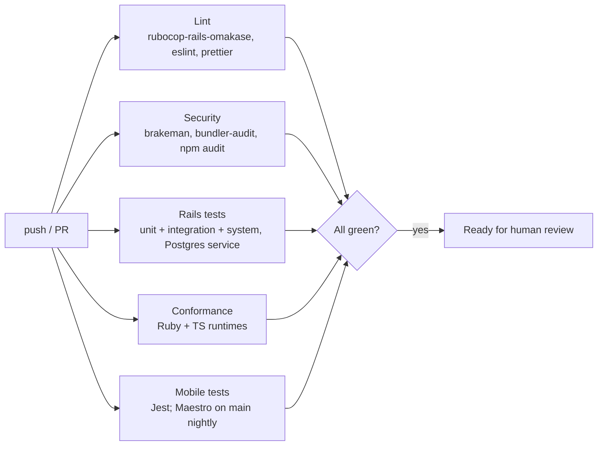

# 10 — Testing strategy

Reliability is the product, so tests are part of the design, not an afterthought. Every task's
definition of done includes its tests ([12](12-delivery-workflow.md)).

## Server (Rails)

Minitest with fixtures (Rails defaults; the legacy suite also used Minitest). Parallel test
runs on.

| Layer | What | Notes |
|-------|------|-------|
| Model / unit | Validations, domain services, form runtime, policies | Fast; every Pundit policy has tests |
| **Integration (request) tests** | Every controller action and API endpoint: status codes, payloads, authorization, side effects | **The main layer.** Covers the behaviour users and devices rely on |
| API contract | Request tests validate requests/responses against `docs/api/openapi.yaml` (`committee` gem) | Mobile and server can't drift silently |
| System tests | Critical journeys in a headless browser: invite → accept → capture; build → publish form; review; client dashboard | Few, stable, high value |
| Job tests | Processing pipeline, exports, retention, earnings | Run jobs inline in tests |
| Migration safety | `strong_migrations` in CI | Blocks unsafe migrations |

### Mandatory cross-cutting suites

1. **Tenant isolation suite.** Two agencies with full data sets. For every tenant model: queries
   under agency A never return B's rows (app scope *and* RLS with app scope deliberately
   bypassed). For every route: A's user gets 404 for B's resources. A schema lint test fails if
   a table with `agency_id` lacks an index, a forced RLS policy or a composite FK to its parent.
   *Revised:* the suite connects as a **non-owner database role** (owners bypass RLS) and
   includes a canary test that proves RLS is active: a raw `SELECT` with no `app.agency_id`
   set must return zero rows. It also covers the pre-tenant paths (agency switcher,
   invitation lookup, device login) and a `load_async` query.
2. **Idempotency suite.** Every device write endpoint called twice, concurrently and in
   sequence, with identical and conflicting payloads → exactly one record, correct status codes,
   conflicting payload quarantined. *Revised:* plus a **cursor-ordering test**: N concurrent
   writers append `sync_events` while a reader polls; the reader must see every event exactly
   once.
3. **Client visibility suite.** For each client view setting, hidden fields/locations/names never
   appear in client HTML, JSON, or export files.
4. **Never-lose-data suite.** Submissions that fail validation, arrive after revocation, reference
   retired versions, or carry bad clocks are stored and flagged — never rejected. *Revised:* a
   `draining` session can upload pre-removal captures and nothing else; a hard-revoked one
   gets `401 {reason: "revoked"}`; a `409` leaves the payload in `submission_conflicts`;
   processing and projection complete with attachments still missing.
5. **Web filler resilience.** *Revised:* a system test fills a form, kills the connection on
   submit, reloads, and asserts the draft is restored and the retried submit produces exactly
   one submission.

## Shared form runtime conformance

The Ruby runtime (server) and the TypeScript runtime (web + mobile) must agree exactly.

- `packages/form-spec/conformance/*.json` contains test vectors:
  `{ definition, answers, expected: { visible, required, errors, calculated } }`.
- Both runtimes run the same vectors in CI. A change to either runtime without a passing vector
  run fails the build.
- Every bug found in form logic adds a vector first.
- *Revised:* vectors cover every custom operator (`date_diff`, `today`, `matches`, repeat
  aggregates), the repeat scoping rules, strict equality, and one vector per lint
  (type change, option value change) that the publisher must reject.

## Mobile

| Layer | Tooling | What |
|-------|---------|------|
| Unit | Jest | Form runtime, renderer logic, outbox state machine |
| Sync engine integration | Jest + a fake API server (driven by the OpenAPI spec) | Retries, partial uploads, 409, auth expiry, cursor handling |
| Database migrations | Jest against SQLite | Upgrade from every released schema version without data loss |
| E2E | Maestro flows on Android emulator (and iOS simulator) | Login → offline capture with photo + GPS → reconnect → synced |
| Chaos | Scripted: kill app mid-upload, toggle airplane mode, fill storage, change clock | Outbox drains exactly once |
| Device lab | Manual pass on a low-end Android (2 GB RAM) before each release | Performance, battery, camera |

## Non-functional checks

- **Load test** (k6) of the submission and sync endpoints before phase 2 launch, at 3× the
  assumed peak.
- **Restore test** of backups weekly in the staging cell ([08](08-deployment-and-operations.md)).
- **Accessibility** checks (axe) on key web pages in system tests.

## CI pipeline (GitHub Actions)

- Rails 8.1's local CI (`bin/ci`) mirrors the same steps so agents and humans can run the full
  suite before opening a PR.
- PRs cannot be merged with a red pipeline; `main` is protected; a human merges.
