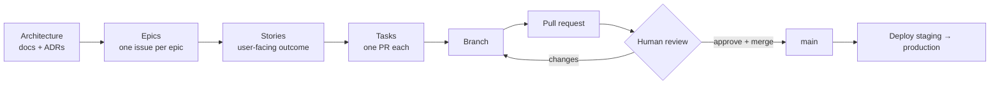

# 12 — Delivery workflow (proposal)

> **Status: draft for agreement.** These conventions become rules in `CLAUDE.md` once agreed.
> They must also be reconciled with the existing local skills on writing for humans and for
> agents, which take precedence where they differ.

## Flow



- A **task** is the unit of work for an agent: small enough for one PR (aim < ~400 changed lines
  excluding generated files), with its own tests.
- An agent picks a task, works on a branch, opens a PR, and stops. **A person merges.**
- If a task reveals that the architecture is wrong, the agent proposes an ADR change in its own
  PR rather than silently diverging.

## Branches

- Trunk: `main` (proposal: retire `develop` after the reset; keep `legacy-v1` tag).
- Branch name: `<type>/<issue-number>-<short-slug>`, e.g. `feat/42-form-version-publishing`,
  `fix/77-duplicate-submission-409`, `docs/12-sync-adr`.
- Types: `feat`, `fix`, `refactor`, `test`, `docs`, `chore`, `ci`, `perf`.

## Commits

[Conventional Commits](https://www.conventionalcommits.org/):

```
<type>(<module>): <imperative summary, ≤ 72 chars>

<why this change is needed, in plain language; what was wrong or missing>
<notable decisions or trade-offs, if any>

Refs #<issue>
```

- `<module>` is one of the modules in [02](02-system-overview.md) (`forms`, `submissions`,
  `sync`, `tenancy`…) or `mobile`, `deploy`, `docs`.
- One logical change per commit; tests in the same commit as the code they cover.
- **No AI co-author or attribution trailers** (no `Co-Authored-By: Claude…`, no
  "Generated with" lines) in commits, PRs or issues. *Revised:* enforce it in tooling rather
  than by instruction — `"includeCoAuthoredBy": false` in `.claude/settings.json` (committed),
  plus a commit-msg hook in CI that rejects the trailers.

## Issues

Three templates (`.github/ISSUE_TEMPLATE/`):

**Epic** — title `[Epic] <name>`; sections: Goal, Scope (in/out), Architecture references
(links to docs/ADRs), Stories (task list), Exit criteria.

**Story** — title `<outcome from the user's view>`; sections: User story
(*As a … I want … so that …*), Acceptance criteria (Given/When/Then), Out of scope,
Parent epic, Tasks (task list).

**Task** — title `<imperative technical change>`; sections: Context (why, links), Scope
(what changes), Acceptance criteria, Test plan (which test layers from [10](10-testing-strategy.md)),
Parent story, Definition of done.

Labels: `type:epic|story|task|bug`, `module:<name>`, `phase:0..4`, `priority:p0..p3`,
`needs:decision`.

## Pull requests

Template (`.github/pull_request_template.md`):

```
## What
<one paragraph: the change, in plain language>

## Why
<the problem it solves; link to the story/task>

## How
<key implementation points a reviewer should know; ADRs followed or changed>

## How it was tested
- [ ] Unit / integration / system tests added or updated
- [ ] `bin/ci` passes locally
- <manual steps, if any, with results>

## Risk and rollback
<what could go wrong; migration reversibility; feature flag>

## Screenshots
<for UI changes>

Closes #<task>
```

## Definition of done (every task)

- Acceptance criteria met; tests at the layers named in the task's test plan.
- `bin/ci` green; no new Brakeman warnings.
- Tenant-owned tables: `agency_id`, index, RLS policy, isolation tests.
- Device-facing changes: OpenAPI updated; idempotency covered.
- Form logic changes: conformance vectors added.
- Docs/ADRs updated if behaviour or decisions changed.
- `.agents/` notes updated (below).

## Agent working notes (`.agents/`, committed)

Regularly updated context so any agent session can pick up where the last one left off.
Never contains secrets or production personal data.

*Revised:* v0.1 proposed git-ignoring this folder. Git-ignored files do not exist in git
worktrees or in CI checkouts, so an agent working in a worktree (the normal case for parallel
agent sessions — this review ran in one and could not see `docs/` for the same reason) would
start with no context at all. The folder is committed; the "no secrets, no personal data" rule
is what makes that safe, and `sessions/` may stay ignored if it gets noisy.

```
.agents/
  README.md            how this folder is organised (kept short)
  context.md           current state: phase, active epic, what's merged, what's next
  conventions.md       distilled rules agents keep getting wrong (links to CLAUDE.md)
  decisions-log.md     dated one-liners: small decisions not worth an ADR
  tasks/<issue#>.md    per-task working notes: plan, progress, open questions, handoff
  sessions/<date>.md   optional session logs
```

Update rules:

- Start of a task: read `context.md` and the task file; create the task file if missing.
- During: append to the task file (plan, blockers, discoveries).
- End (PR opened): write a handoff section in the task file and update `context.md`.
- Anything that should outlive the folder (a decision, a convention) is promoted to an ADR,
  `docs/`, or `CLAUDE.md` via a PR.
